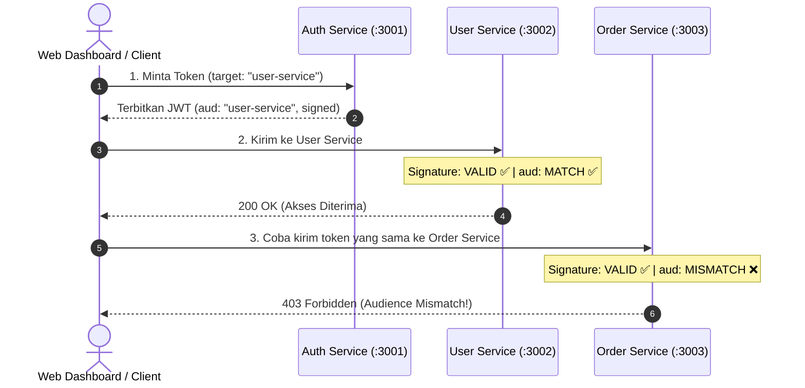

# 🔐 JWT Microservices Security Lab: Pembuktian Claim `aud` (Audience)

[](https://nodejs.org/)
[](https://podman.io/)
[](https://datatracker.ietf.org/doc/html/rfc7519)
[](https://github.com/panva/jose)
[](LICENSE)

Proyek ini adalah **laboratorium interaktif microservices** untuk mensimulasikan dan membuktikan prinsip keamanan mendasar pada JSON Web Token (JWT):

> **"Sebuah token JWT yang valid secara tanda tangan kriptografi (signature) belum tentu boleh digunakan untuk mengakses semua service."**

Dilengkapi dengan **Web Dashboard UI interaktif**, **7 skenario pengujian 1-klik**, dan otomatisasi container berbasis **Podman / Docker Compose**.

---

## 🎯 Mengapa Klaim `aud` (Audience) Sangat Krusial?

Dalam arsitektur microservices, beberapa service sering kali mempercayai Identity Provider (Auth Service) atau menggunakan *Shared Secret* yang sama.

Jika backend service hanya mengecek:
1. Apakah signature-nya asli? (`Valid`)
2. Apakah token belum kedaluwarsa? (`exp`)

Maka timbul kerentanan **Confused Deputy Problem** atau **Token Replay**:
- Token yang diterbitkan khusus untuk membaca profil akun di `user-service` dapat dicuri atau disalahgunakan untuk mengeksekusi transaksi belanja di `order-service`.
- Karena kedua service menggunakan kunci yang sama, signature token tersebut tetap dianggap **sah 100%**.

### Solusi Standar (RFC 7519):
- **Auth Service** menyematkan target spesifik: `"aud": "user-service"`.
- **User Service** memastikan `"aud" === "user-service"`.
- **Order Service** menolak jika `"aud"` bukan `"order-service"` (**HTTP 403 Forbidden**), meskipun signature-nya asli!

---

## 🏛️ Arsitektur Sistem



| Service | Port | Peran | Validasi Klaim `aud` |
| :--- | :---: | :--- | :--- |
| **`auth-service`** | `3001` | Menerbitkan JWT & menyajikan Dashboard UI | Menentukan `aud` sesuai target |
| **`user-service`** | `3002` | Endpoint Profil (`GET /api/users/profile`) | **Wajib** `"aud": "user-service"` |
| **`order-service`** | `3003` | Endpoint Order (`GET /api/orders`) | **Wajib** `"aud": "order-service"` |

---

## 🧪 7 Skenario Pembelajaran Interaktif

Web dashboard dan skrip pengujian menyediakan 7 skenario siap uji:

| No | Skenario | Nilai `aud` | Ekspektasi | Konsep Keamanan |
| :-: | :--- | :--- | :-: | :--- |
| **1** | **Akses Sah User Service** | `"user-service"` | **`200 OK`** | Alur normal: signature valid & audience cocok. |
| **2** | **Akses Sah Order Service** | `"order-service"` | **`200 OK`** | Alur normal untuk order service. |
| **3** | **Audience Mismatch** | `"user-service"` | **`403 Forbidden`** | **Inti Eksperimen:** Signature asli dari Auth Service, tapi ditolak karena beda target service (*Confused Deputy Protection*). |
| **4** | **Manipulasi Token (Tampered)** | Diedit manual | **`401 Invalid Sig`** | Mengubah payload tanpa Secret Key otomatis merusak signature kriptografinya. |
| **5** | **Token Expired (Kedaluwarsa)** | `exp` lampau | **`401 Expired`** | Validitas waktu kedaluwarsa (`exp`) wajib divalidasi oleh service. |
| **6** | **Multi-Audience Array** | `["user-service", "order-service"]` | Keduanya **`200 OK`** | Standar RFC 7519: satu token resmi boleh memiliki multi-target jika diizinkan. |
| **7** | **Request Tanpa Token** | Tanpa Bearer | **`401 Missing`** | Endpoint terproteksi menolak request tanpa token. |

---

## 🚀 Panduan Instalasi & Menjalankan

### Menggunakan Podman (Direkomendasikan)
```bash
# 1. Jalankan semua microservice di background
podman compose up --build -d

# (Jika menggunakan podman-compose berbasis python: podman-compose up --build -d)

# 2. Periksa status container
podman compose ps
```

### Menggunakan Docker
```bash
docker compose up --build -d
```

> **Catatan Pengguna Windows (Podman Machine):**  
> Di Windows, Podman berjalan di dalam VM (WSL2/Hyper-V) yang memiliki IP virtual (misal `192.168.54.202`).  
> Dashboard UI secara otomatis mendeteksi alamat host browser Anda (`window.location.hostname`). Anda dapat mengaksesnya via `http://localhost:3001` atau `http://<IP-PODMAN-MACHINE>:3001`.

---

## 🔬 Cara Pengujian

### Cara 1: Web Dashboard Interaktif (Paling Visual & Praktis)
1. Buka browser ke: **`http://localhost:3001`** *(atau IP Podman Machine)*.
2. Klik salah satu dari **7 kartu skenario** di bagian atas.
3. Klik tombol **"⚡ Jalankan Skenario Ini ke Kedua Service"**.
4. Anda akan melihat hasil perbandingan langsung kedua service secara berdampingan lengkap dengan penjelasan teknisnya!

### Cara 2: Skrip Otomatis CLI (Terminal)
Jalankan skrip *test runner* otomatis:
```bash
node test.js
# atau
npm test
```
Skrip ini akan memvalidasi ke-7 skenario secara otomatis dan menampilkan log berwarna di terminal.

### Cara 3: Menggunakan `test.http` (VS Code REST Client)
Buka file [`test.http`](test.http) dan klik **"Send Request"** di atas endpoint yang ingin Anda uji secara modular.

---

## 🔍 Bedah Kode Verifikasi (`jose`)

Implementasi validasi di [services/order-service/server.js](services/order-service/server.js):

```javascript
import * as jose from 'jose';

try {
  // 1. jose.jwtVerify memverifikasi SIGNATURE terlebih dahulu
  // 2. Jika signature sah, jose membandingkan claim 'aud' dengan EXPECTED_AUDIENCE
  const { payload } = await jose.jwtVerify(token, secretKey, {
    issuer: 'auth-service',
    audience: 'order-service' // Wajib bernilai 'order-service'
  });

  // Lolos verifikasi
  req.user = payload;
  next();
} catch (err) {
  // KASUS 1: Signature VALID, tapi nilai claim 'aud' salah!
  if (err.code === 'ERR_JWT_CLAIM_VALIDATION_FAILED' && err.claim === 'aud') {
    return res.status(403).json({
      error: 'AUDIENCE_MISMATCH',
      message: 'Token memiliki signature valid, namun bukan ditujukan untuk service ini!'
    });
  }

  // KASUS 2: Signature token dimanipulasi / kunci salah!
  if (err.code === 'ERR_JWS_SIGNATURE_VERIFICATION_FAILED') {
    return res.status(401).json({ error: 'INVALID_SIGNATURE' });
  }

  // KASUS 3: Token kedaluwarsa
  if (err.code === 'ERR_JWT_EXPIRED') {
    return res.status(401).json({ error: 'TOKEN_EXPIRED' });
  }
}
```

---

## 📁 Struktur Direktori

```text
├── docker-compose.yml       # Konfigurasi container multi-service
├── podman-compose.yml       # Alias konfigurasi untuk Podman
├── package.json             # Root package script
├── test.js                  # Automated test runner CLI
├── test.http                # REST Client collection
└── services/
    ├── auth-service/        # Port 3001: Penerbit JWT & Web Dashboard UI
    │   ├── Dockerfile
    │   ├── server.js
    │   └── public/index.html
    ├── user-service/        # Port 3002: Service Profil (aud: user-service)
    │   ├── Dockerfile
    │   └── server.js
    └── order-service/       # Port 3003: Service Order (aud: order-service)
        ├── Dockerfile
        └── server.js
```

---

## 🛑 Menghentikan Container

```bash
podman compose down
# atau
docker compose down
```

---

## 📄 Lisensi
Didistribusikan di bawah lisensi [ISC](LICENSE). Dibuat untuk tujuan edukasi arsitektur keamanan microservices.
